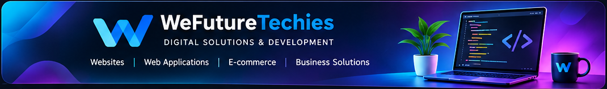

  

<h1 align="center">Hi, I'm Krishnaraj 👋</h1>
<h3 align="center">Freelance Web Developer · WeFutureTechies</h3>

I build modern, responsive websites and practical web applications for businesses, startups and entrepreneurs.

  <a href="https://wefuturetechies.vercel.app/"><strong>🌐 Visit Portfolio</strong></a> ·
  <a href="https://wefuturetechies.vercel.app/projects"><strong>🚀 View Projects</strong></a> ·
  <a href="https://github.com/Krishnaraj2409"><strong>💻 GitHub</strong></a>

---

## About Me
I'm a web developer focused on creating clean, responsive and user-friendly digital experiences.

- 🌐 Building business websites and web applications.
- 🛒 Interested in e-commerce and business solutions.
- 🎨 Focused on responsive UI and practical user experiences.
- 📱 Prefer mobile-first, lightweight implementations.
- 🌱 Continuously learning and improving my development skills.

## Services
| Service | What I can help build |
|---|---|
| 🌐 Website Development | Business websites, company websites and landing pages |
| ⚙️ Web Applications | Custom web interfaces and business tools |
| 🛍️ E-commerce Solutions | Product catalogues and online storefront experiences |
| 🎨 UI Development | Responsive layouts and user-friendly interfaces |
| 🔧 Website Improvements | UI updates, responsive fixes and maintenance |

## Featured Projects
| Project | Description | Live link |
|---|---|---|
| **CSC Enquiry** | Citizen service enquiry portal. | [Live Demo ↗](https://cscenquiry.vercel.app/) |
| **Signage Board** | Digital signage solution for configuring and previewing display boards. | [Live Demo ↗](https://signageboard-v1.vercel.app/) |
| **MeatHub** | Online meat and food storefront. | [Live Demo ↗](https://meathubv1.vercel.app/) |
| **Aura Health** | Healthcare and wellness website interface. | [Live Demo ↗](https://aura-health-ui.vercel.app/) |
| **Sri Sivasakthi Agro** | Agriculture and business website. | [Live Website ↗](https://www.srisivasakthiagro.in/) |
| **Car Management** | Car rental and vehicle management web interface. | [Live Demo ↗](https://car-rent-frontend-two.vercel.app/) |

<a href="https://wefuturetechies.vercel.app/projects"><strong>Explore all projects on WeFutureTechies →</strong></a>

## Tools & Technologies

  
  
  
  
  
  
  
  
  
  
  

## 📊 Developer Activity

  <strong>BUILDING · LEARNING · CREATING</strong> 
  My development journey on GitHub

  

### 💻 Explore My Development Work

  
  

  <em>Every project is another step forward.</em>

## Let's Work Together
Have a website idea or need a digital solution for your business? Let's talk about your requirements.

  
  

<strong>WeFutureTechies</strong> <em>Building Digital Solutions. Creating Future Possibilities.</em>

